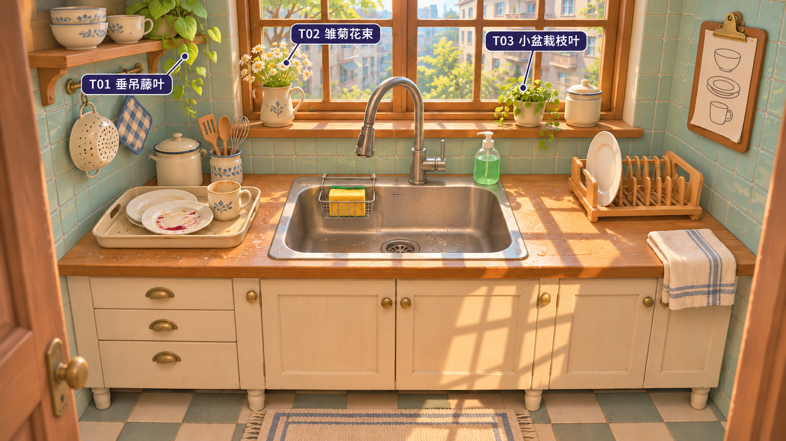

# 《洗碗时光》厨房资产制作分工

按首个可玩版本的固定站位、可转动的盘子与杯子，以及第一人称擦洗近景评估。建议把 **3 处植物的外形**列为 Tripo 候选。其中 T03 适合先试，T01 和 T02 适合拆成可复用的小段生成。**水槽、餐具、工具和架子由 Blender 主建**，在 Godot 中用同一套餐具验证抓握、命中与摆放。

## Tripo 候选与确认单

图中编号指向植物本体。花壶、花盆另用 Blender 制作，便于调整植株高度、统一陶器材质，也能在不同订单场景里换盆复用。三个编号代表三处场景用物，每处的生成范围如下。

| 确认 | 图中资产 | 建议交给 Tripo 的部分 | Blender 收尾与取舍 |
| --- | --- | --- | --- |
| ☐ T01 | 左上搁板的垂吊藤叶 | 一小段带数片宽叶的藤条。它的辨识度来自叶尖方向、疏密和垂坠弧线。原图顶部已截断，另准备一张枝段完整的单体图。 | 清掉叶片间的连片后，复制、旋转枝段，沿搁板垂下。若修叶耗时较长，保留一片好叶，在曲线上手排即可。 |
| ☐ T02 | 左窗台陶壶里的雏菊 | 一枝由花冠、花心和短茎组成的雏菊。生成范围最小，风险最高，细花瓣从近处容易显成厚块。 | 用少量朝向不同的花头组成一束，茎插入壶口。按玩家站位检查白花是否仍有清晰的轮廓。若花心和花瓣糊成一团，直接用简化花冠实例排布。 |
| ☐ T03 | 右窗台小盆栽的枝叶 | **建议优先试做。** 生成盆口以上的一簇枝叶，保留侧面两三枝自然垂出的轮廓。植株小、以整体入镜，适合评估生成有没有节省摆叶时间。 | 在 Blender 制作圆盆，以盆口为基准调整株幅。检查叶簇内部空隙、背面法线和枝条与盆边的穿插。合格后再投入另外两项。 |

**试做通过条件。** 把 T03 放回游戏镜头，分别在日照和阴影下看一次。边缘能读出叶片的层次，枝叶与窗外背景有间隙，转动光源后叶面颜色自然，即可保留。记录准备单体参考、生成和修整的总用时，与在 Blender 里复制叶片做一盆的耗时比较，再决定 T01、T02 的投入。

## Blender 直接搭建的资产

| 图中资产 | 直接搭建的理由 | 做法与可见的验收结果 |
| --- | --- | --- |
| 台面左侧的脏盘、马克杯，右侧架内的净盘，搁板上的碗杯 | 同一只盘子要经历拿起、翻面、擦洗、入架。如果干净盘和脏盘各自生成，边缘和厚度可能不同，抓握点和槽位就需要分别配。 | 旋转截面建出盘足、盘背、杯内壁和杯底，杯柄独立塑形并留出指孔。干净与脏状态共用网格，污渍另做局部区域。翻面时只能擦到朝向工具的一侧，从杯口探入可命中内壁。 |
| 水槽、排水口、台面开孔 | 三者在画面中心紧贴相接。金属的视觉效果主要取决于盆沿倒角、曲面法线与粗糙度。 | 先统一开孔与盆沿尺寸，再压出内腔、嵌排水口。镜头从上方看得到槽底，玩家把餐具放回水槽时有明确落点。 |
| 弯颈水龙头、抽拉喷头、把手 | 出水嘴决定水流起点，拿起的喷头和转动的把手需要各自的转轴。 | 用曲线做弯管，喷头和把手分件，在出水口留定位点。装回喷头时与弯管对齐，水流从喷嘴射出。 |
| 黄色海绵、金属海绵篮、泵瓶 | 玩家会贴近观察海绵与盘面的接触。泵瓶的外壳、绿色液体和泵头需要不同的材质或动作。 | 海绵用倒角块和孔隙纹理，留一面作为擦洗面。篮子用曲线复用铁丝。瓶壳与液面分开，按压时只移动泵头。在手部参考姿势下检查海绵贴盘、泵嘴朝向。 |
| 木质沥水架、待洗托盘 | 架齿间距受盘沿厚度约束，槽位还要能被程序准确识别。托盘的内面决定餐具放回时的支撑高度。 | 先完成标准盘，再阵列架齿；每个可用槽在 Godot 配一个吸附点。用同一只盘逐槽摆放，检查相邻餐具和架齿之间的间隙。 |
| 柜体、门板、拉手、搁板、墙砖、地砖、木窗、窗台和门框 | 可测量的重复结构占画面大部，一套尺寸和材质就能统一比例。 | 复用板件、倒角和拉手，地砖与墙砖用可平铺材质。先从固定机位对齐台面高度、窗宽和左右操作距离，再补边缘细节。 |
| 花壶、窗台小盆、带盖罐、厨具筒、木铲、勺、打蛋器、挂杆和漏勺 | 陶器以旋转体为主，工具的薄边、铁丝和镂空都有可重复的几何规律。手建后容易保住空隙，也可让杯、罐、壶共享蓝白花纹。 | 壶身旋转成形，把手沿曲线塑形。打蛋器复用弯折铁丝，漏勺按观看距离选用真实孔洞或镂空材质。筒和工具分件，摆放时能调整高低。 |
| 挂布、台边条纹毛巾、地垫、右侧订单夹板 | 布巾的轮廓取决于挂钩和台边的位置，条纹需要沿褶皱连续。夹板上的订单也会随关卡更换。 | 在实际支撑物上手调褶皱或模拟后定型，地垫用薄片与织物材质。夹板、夹子和纸面分层，纸面留给 Godot 切换图案。 |

**窗外与洗碗反馈。** 固定站位下，远处公寓和树冠先用分层背景卡表现，从允许的左右转头范围检查窗框边缘是否露空。窗格光影交给 Godot 灯光。盘上的酱痕、台面积水、泡沫和水流分别用可改变的污渍区域、材质或粒子表达，擦洗进度与污渍可见度共用同一份状态。

**第一人称手部。** 手部参考图是单独的近景资产。若要在游戏中显示双手，建议在 Blender 使用有可用授权和骨骼的手部基础网格，按盘沿和海绵调整握姿。重点检验翻盘时拇指能贴住盘沿、海绵能压住盘面，以及切换工具时手指能松开。[查看手部参考图](player-hands-reference.png)

## 从参考图到 Godot

1. **先用 Blender 定尺寸。** 用一个盘子、一只杯子、一个沥水槽位和一块海绵搭出可测试的台面。将这套餐具的尺寸用于后续模型和抓握点。
2. **按编号准备单体参考。** 全景用于确认位置、色调和相对大小。选中的植株另备完整、背景干净、光线均匀的单体图，必要时补同一物体的侧面或背面。原图中互相遮挡的枝叶和被截断的顶端需要单独设计。[Tripo 单图输入指南](https://www.tripo3d.ai/help/features/how-to-get-better-image-to-3d-results) · [Tripo 多视图说明](https://www.tripo3d.ai/product-doc/model-generation/multi-view-to-3d)
3. **在 Blender 验收生成物。** 以盆口、壶口或枝段根部设置原点。清理碎片和多余内部面，检查叶背、贴图中的固定阴影以及过密网格。将确认后的模型按实际比例导出为 GLB，静态植物只保留渲染所需结构。
4. **在 Godot 实机位复核。** 先看窗台剪影和色彩，再完成一次拿盘、翻面、擦洗、入架的操作。交互射线应命中手边餐具，窗台装饰可省略碰撞。以实际游玩距离和目标机器上的帧时间决定是否继续加细。
