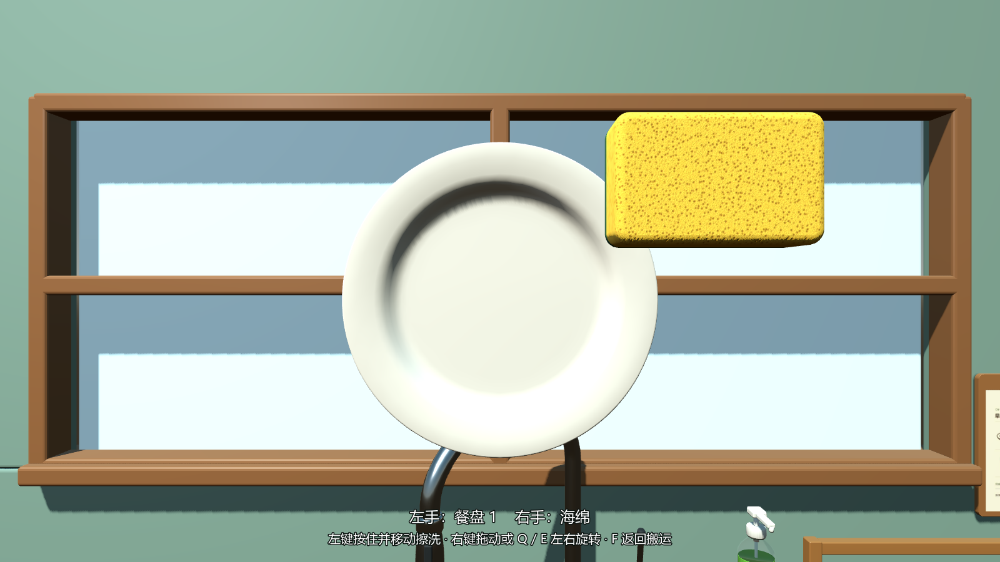

# 厨房可玩入口

> 第 1～11 步及普通工具操作、沉浸中键旋转追加需求｜2026-11-26｜用户已确认验证通过

打开 [project.godot](../../../project.godot)，等待导入后按 F5，运行 [kitchen-game.tscn](../../../Scenes/kitchen-game.tscn)。独立展示器仍可打开 [kitchen-demo.tscn](../../../Scenes/kitchen-demo.tscn) 按 F6，使用 1～4、R、右键拖动和失焦释放。

## 当前操作

| 场景／输入 | 当前行为 |
| --- | --- |
| WASD、鼠标 | 普通状态按镜头水平朝向行走并直接观察，胶囊阻挡厨房柜体、地面和边界；沉浸及过渡停止行走与环顾 |
| 准星、左键（未持工具） | 1.5 米内第一处真实表面识别餐具／清洗工具；左键拿取。先拿的在左下、第二件在右下，允许两餐具或餐具加一个工具 |
| 左键按住（普通持工具） | 中央准星瞄准已放置餐具，海绵贴面持续擦动并压缩，喷头对准真实命中点；可边走边看，松开回原手位。移开、遮挡、超距停止接触，仍按住时重新命中可继续；尚无出水或去污 |
| E（普通状态） | 可拿取目标餐具；持工具且另一手为空时优先拿取目标餐具，其他持工具情形尝试归回。工具归回须原位 1.5 米内且无遮挡，另一手不换边；未持工具时也可拿取海绵／喷头 |
| F | 一件餐具加一个工具时进入沉浸；只移动同一餐具、保持玩家位置／观察方向／FOV。沉浸中仅 F 返回搬运 |
| 1／2（普通持餐具） | 分别选择左手／右手餐具，HUD 名称后显示“当前”。只有一件自动选中；第二件拿起保留原选择；空手／工具不可选，提示后保留原选择，不调换手位 |
| 鼠标（沉浸） | 海绵、喷头在画面内自由跟随；移出餐具或旋转后不自动吸附、收回，四角限制保证模型完整可见 |
| 左键按住（沉浸） | 命中当前餐具才主动接触／瞄准。海绵须移动才计擦洗并压缩，喷头实际喷嘴对准命中点；松开恢复自由移动，尚无出水或去污 |
| 中键拖动、Q/E（沉浸） | 旋转餐具；Q 左、E 右，按住连续旋转，松开停止。同时按住抵消。旋转中停止使用，不转镜头；沉浸右键不旋转、不放大，也不取消左键使用 |
| F 返回后 | 餐具角度和左右手位保留，工具回原固定手位；随后才用 E 归回世界原位 |
| 右键（空手／只持工具） | 临时收窄 FOV，松开、菜单、失焦或持物模式改变后复原；独占持瓶上下文仍由测试构造 |
| Esc、失焦 | 显示菜单并释放鼠标，停止旧移动、观察、使用和旋转；继续游戏不恢复旧输入。当前不冻结场景树 |

1/2/3 不切换、生成或归回实体工具。Q 在沉浸只旋转；搬运的餐具 Q 返回只有输入意图，尚未执行。普通搬运持餐具时右键不放大；实际搬运旋转、滚轮和允许范围待第 16 步。

托盘初始两盘一杯，沥水架为空。水槽内“临时盘位”“临时杯位”可识别，但完整放置尚未实现。双持两件餐具后，可停止并重新 F5，再测试餐具加工具；当前没有手动放下餐具的动作。

普通操作可先只拿海绵或喷头，对准托盘上的盘杯按住左键；它不拿起餐具或更改目标占用，也不操作手中餐具。想操作所持餐具时，同持餐具与工具并按 F。普通工具姿态受近裁剪、空间与接近路径检查，喷头还须距原位 1.5 米内；模型接触不表示已满足供水或湿润条件。

## 已知边界与后续

第 11 步统一只读放置判定与 1／2 目标选择已验收，第 12 步落位预览尚未开始；实际放下和 Q 返回仍在第 13、14 步。判定本身不改变节点、占用或运行状态，不预留目标。只有沥水位要求对应实例的实际 95% 清洁度，待洗位和临时位允许脏餐具，泡沫不阻止入架。OrderState／DishState 尚未绑定玩法，缺少清洁状态时不授权入架；专项使用已知状态验证门槛。

共享判定覆盖 13 位完整姿态、注册身份、兼容、尺寸（含杯柄）、来源与目标占用、1.5 米距离、视锥、第一处真实遮挡和最终几何空间。它不模拟插入过程；供水、湿润、施液、去污、泡沫及订单仍未绑定实际玩法，工具接触不表示已清洁。泵瓶当前仍是静态世界模型。

背景模糊仍在第 17 步：只模糊厨房，餐具、工具、污渍、泡沫和 UI 保持清晰。第 18 步才做完整暂停。喷头已使用实际模型和连续动态软管，但软管仍是简化曲线，可能穿过餐具，长度限制与避障在供水步骤补齐；不能据此宣称完整软管物理已通过。

## 实现与文件边界

入口继承生成的厨房布局，清除根浏览脚本、隐藏 ViewerOverlay、停用旧相机并隐藏原展示餐具。实际相机为 Player/ViewCamera；F6 原展示器保持原样。

| 文件 | 当前作用 |
| --- | --- |
| [Scenes/kitchen-game.tscn](../../../Scenes/kitchen-game.tscn) | 手工组装输入、HUD、玩家、步行碰撞、三件餐具、环境表面、世界工具、槽位、查询与持物控制器；生成器不得覆盖 |
| [Scenes/player.tscn](../../../Scenes/player.tscn) | 玩家胶囊、相机，以及左／右搬运与清洗锚点 |
| [Scenes/game-hud.tscn](../../../Scenes/game-hud.tscn)、[game_hud.gd](../../../Scripts/UI/game_hud.gd) | 准星目标名、左右手状态、按模式显示的操作提示和菜单 |
| [game_input.gd](../../../Scripts/Input/game_input.gd) | 17 个映射的未消费输入、普通持工具持续使用与 E 优先级；沉浸中键和 Q/E 旋转、鼠标模式及持续输入清除 |
| [dish_carry.gd](../../../Scripts/Dishes/dish_carry.gd) | 双手拿取原实例、来源占用解除、安全搬运、普通工具接触与 contact_dish、F、旋转、自由工具及 E 归回 |
| [hand_item.gd](../../../Scripts/Dishes/hand_item.gd) | 每手独立节点、来源、姿态、包围盒、查询形状及安全位置缓存 |
| [cleaning_tool.gd](../../../Scripts/Tools/cleaning_tool.gd) | 原工具身份、类型、归位父节点和姿态，以及归回距离／遮挡检查 |
| [world_cleaning_tools.gd](../../../Scripts/Tools/world_cleaning_tools.gd) | 在真实表面生成后封装原工具并移除旧遮挡；更新喷头软管与归位显示 |
| [dish_targeting.gd](../../../Scripts/Interaction/dish_targeting.gd)、[mesh_surface_collision.gd](../../../Scripts/Interaction/mesh_surface_collision.gd) | 第一处真实表面、持物排除及工具层；沉浸目标由 DishCarry 管理，不被世界查询清除 |
| [kitchen_slot_registry.gd](../../../Scripts/Slots/kitchen_slot_registry.gd) | 13 位初始化、独立 SlotState 占用和当前来源读取；initial_slot_id 仅用于初始化 |
| [placement_rules.gd](../../../Scripts/Slots/placement_rules.gd)、[placement_result.gd](../../../Scripts/Slots/placement_result.gd) | 第 11 步共用只读判定和结构化结果；由 DishCarry.check_placement 使用当前选中手位调用，后续预览、确认和 Q 返回提交前须重查 |

完整文件职责、配置与生成器列表见 [architecture.md](../../memory-bank/architecture.md)。世界查询掩码为 13：餐具 1、环境 4、清洗工具 8；玩家 2 和步行代理 16 被排除。沉浸表面检测只读餐具层，再要求命中当前所持实例。工具和环境使用实际三角面，继续保留杯内、杯柄孔与盆底开口。

运行工具包装发生在环境表面生成之后、槽位／目标／持物控制启动之前，避免重复模型与幽灵遮挡。源 GLB、Blender、资产生成器和展示场景未为此修改。现有 build_kitchen_demo.gd 只覆盖展示场景，Blender 总场景生成器只负责其资产及预览；不得覆盖玩法场景或脚本。

## 验证与来源

第 1～11 步及追加需求已由用户确认通过。AI 实施期间实际运行专项与相关回归；具体范围与结果见 [progress.md](../../memory-bank/progress.md)。在仓库根目录运行，各项应退出 0 且无脚本错误：

```powershell
$godotExe = 'D:\Godot\Godot_v4.7.2-stable_win64_console.exe'
& $godotExe --headless --editor --path . --quit
& $godotExe --headless --path . --script Tools/verify_dish_carry.gd
& $godotExe --headless --path . --script Tools/verify_dual_wield.gd
& $godotExe --headless --path . --script Tools/verify_game_input.gd
& $godotExe --headless --path . --script Tools/verify_world_tool_use.gd
& $godotExe --headless --path . --script Tools/verify_placement_rules.gd
```

成功标识依次为 DISH_CARRY_OK、DUAL_WIELD_OK、GAME_INPUT_OK、WORLD_TOOL_USE_OK、PLACEMENT_RULES_OK。搬运专项覆盖三餐具、来源和占用、左下构图、36 个障碍姿态及中断；双持专项覆盖两工具和两种拿取顺序、F、中键／Q/E、沉浸右键无旋转、自由移动和四角、实际喷嘴瞄准、软管段连续、E 归回及手位保持。普通工具专项覆盖左右手、盘杯、原占用不变、持续瞄准、WASD／观察、遮挡、超距、菜单／失焦及使用中 E 拿取和 F 共存。脚本只改实例内存，不写场景、资产、配置或进度。

已有回归脚本仍为 verify_player_movement.gd、verify_mouse_look.gd、verify_dish_targeting.gd、verify_kitchen_slots.gd、verify_runtime_state.gd 和 verify_cleanliness.gd。图形捕获、鼠标手感和真实窗口失焦由 F5 交互检查，无头脚本不代替用户试玩或性能测量。

新增第 11 步专项成功输出 PLACEMENT_RULES_OK，覆盖实际清洁度门槛、泡沫、未知／错配状态、注册、类型／尺寸、占用、距离／遮挡、真实空间、只读行为及 1／2 选中手位。实施阶段输入、双持、普通工具、槽位、运行状态和清洁度六项回归均通过。F5 拿起两件餐具，按 1／2 检查“当前”标记；此阶段左键和 Q 不执行放下。

## 当前玩法预览

2026-11-26 第 11 步手位选择预览：左手餐盘、右手马克杯，按 2 后右手名称显示“当前”。该画面只证明手位选择与 HUD，实际放下仍未实现。


2026-11-26 普通模式操作预览，使用 Godot 图形模式渲染并查看。海绵贴面擦动、喷头对准目标，尚无供水或去污；软管仍可能穿过餐具。沉浸现用中键旋转，下面保留的 2026-11-24 沉浸截图属于历史画面，其旧右键提示以当前操作表为准。

| 普通海绵操作 | 普通喷头瞄准 |
| --- | --- |
|  |  |

以下为 2026-11-24 用实际 Godot 图形模式渲染并查看的操作原型。没有背景模糊、水流或污渍，软管避障仍未完成；这些截图不证明整单清洗已可玩。

| 双手搬运 | 海绵自由移动 | 喷头自由移动 |
| --- | --- | --- |
|  |  |  |
